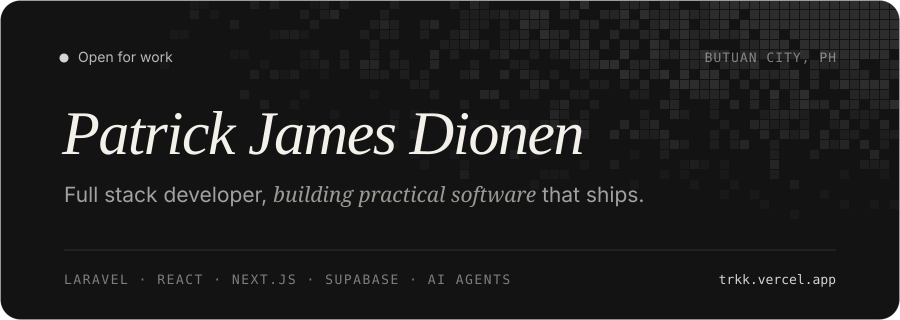
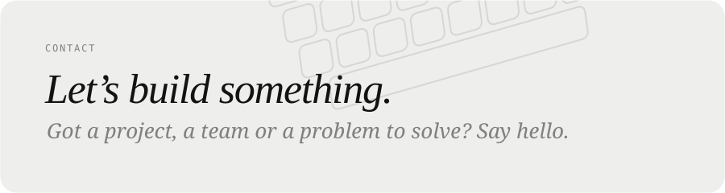

  

I build practical, scalable software and turn ideas into working products. I work across the stack, focus on clean architecture and maintainable code, and ship meaningful features, one commit at a time.

## What I do

- Build responsive web apps, extensions and desktop applications
- Design scalable backend systems and APIs
- Keep improving code quality through refactoring and best practices
- Work with AI agents to ship features faster

 

  

  <a href="https://trkk.vercel.app"><b>Portfolio</b> ↗</a>
  &nbsp;·&nbsp;
  <a href="https://www.linkedin.com/in/patrick-james-dionen-1b22aa2b1/"><b>LinkedIn</b> ↗</a>

